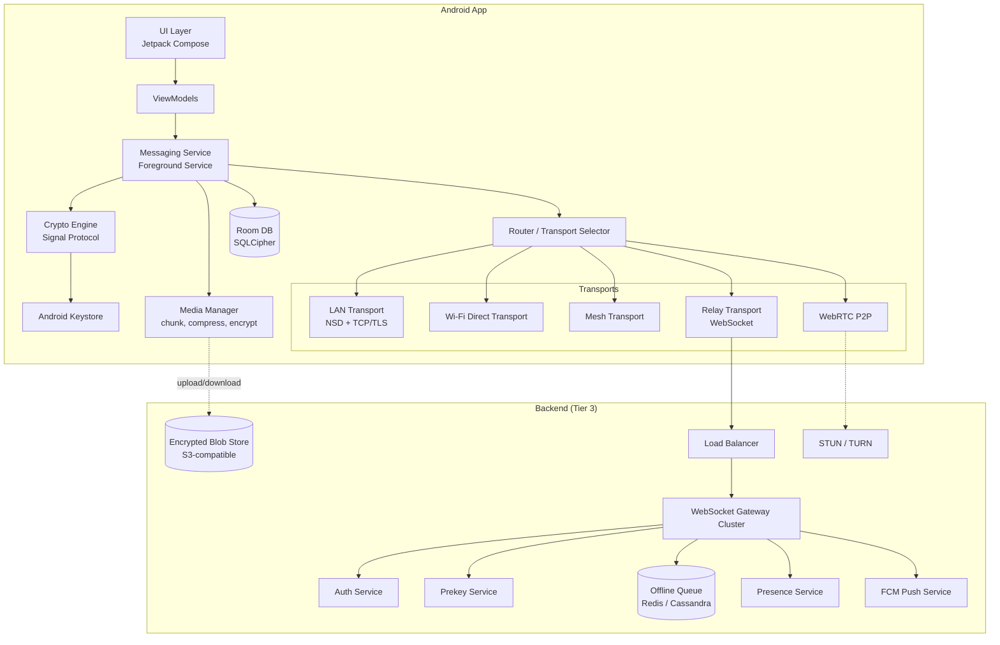
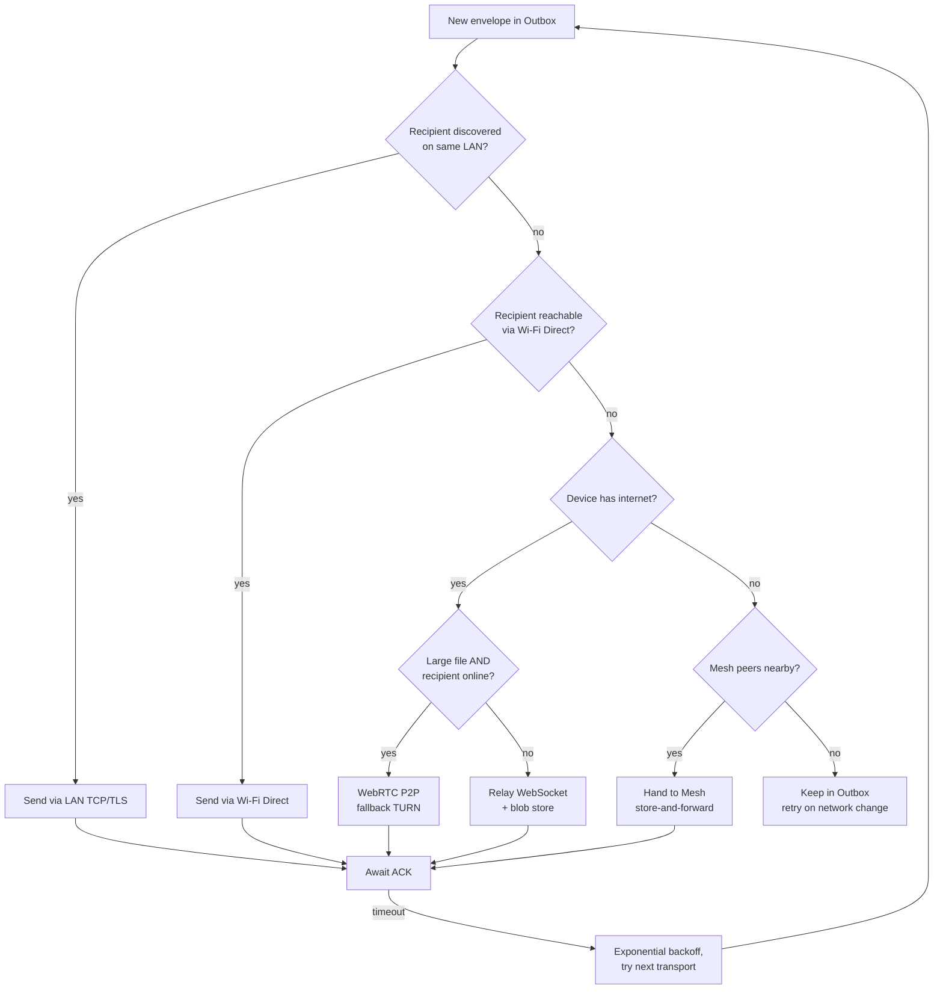
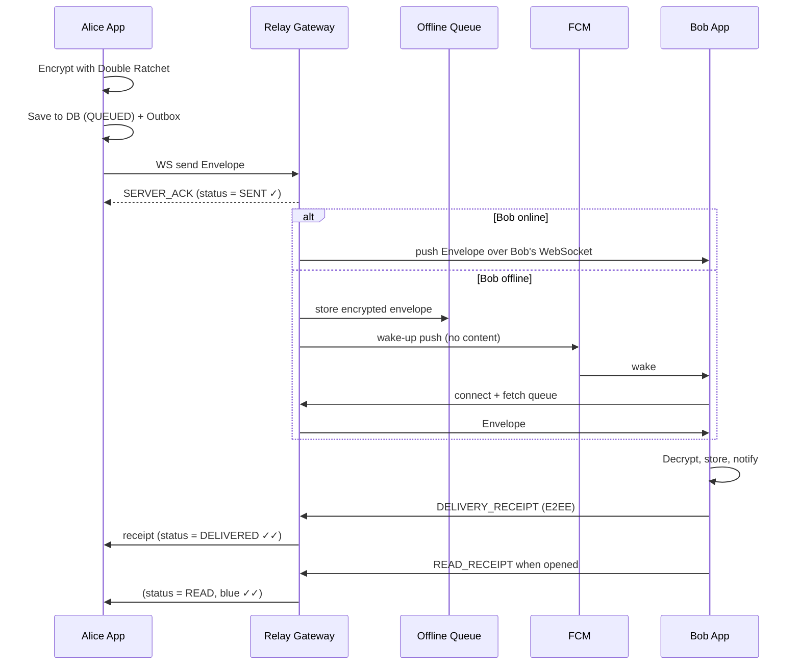
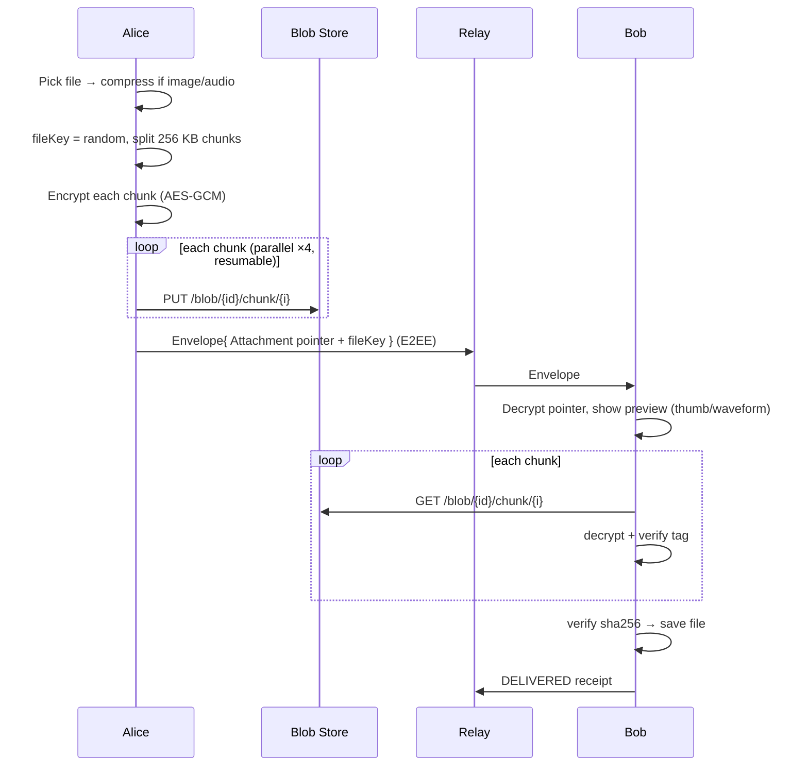

# WiChat — System Design & Logic

A secure Android messaging app that sends **text, documents, images, audio (voice notes) and video** over Wi-Fi, and lets users reach people **nearby (same Wi-Fi / no internet)** or **miles away (across cities/countries)**.

---

## 1. Goals & Requirements

### Functional
| # | Requirement |
|---|-------------|
| F1 | Send/receive text messages (1-to-1 and group) |
| F2 | Send documents (PDF, DOCX, ZIP…), images, video, audio files and recorded voice notes |
| F3 | Work on a local Wi-Fi network **without internet** (same router or Wi-Fi Direct) |
| F4 | Reach users **miles away** when any path to the internet exists |
| F5 | Offline delivery: messages queue and deliver when the recipient comes online |
| F6 | Delivery states: Sending → Sent → Delivered → Read |
| F7 | Contact discovery (phone number / username / QR code) |
| F8 | Resume interrupted file transfers |

### Non-functional
| # | Requirement |
|---|-------------|
| N1 | **End-to-end encryption (E2EE)** — server/relays can never read content |
| N2 | Forward secrecy & post-compromise security |
| N3 | Large files up to 2 GB via chunking |
| N4 | Battery-friendly (no constant polling) |
| N5 | Scales to millions of users on the relay tier |

---

## 2. The "Miles Away" Problem — How It Is Possible

Wi-Fi radio range is only **~50–100 m** indoors (≈200 m with Wi-Fi Direct outdoors). A phone **cannot** reach a phone miles away by radio alone. WiChat solves this with **three transport tiers**, choosing the best one automatically:

```
 ┌─────────────────────────────────────────────────────────────────────┐
 │ TIER 1 — LOCAL (0–100 m)   Same Wi-Fi LAN or Wi-Fi Direct           │
 │   Phone A ──Wi-Fi──► Phone B          (no internet, no server)      │
 ├─────────────────────────────────────────────────────────────────────┤
 │ TIER 2 — MESH (100 m – few km)   Multi-hop store-and-forward        │
 │   A ──► C ──► D ──► E ──► B     (each phone relays encrypted blobs) │
 ├─────────────────────────────────────────────────────────────────────┤
 │ TIER 3 — GLOBAL (any distance)   Wi-Fi → Internet → Relay server    │
 │   A ──Wi-Fi──► Router ──Internet──► WiChat Relay ──► ... ──► B      │
 │   Direct P2P via WebRTC (NAT hole-punching) when possible           │
 └─────────────────────────────────────────────────────────────────────┘
```

### Tier 3 is the main answer for "miles"
1. Phone A connects to **any Wi-Fi with internet** (home, café, campus).
2. The app opens a persistent **TLS WebSocket** to the WiChat Relay cluster.
3. A sends an **already-encrypted** envelope addressed to B's user ID.
4. If B is online → relay pushes it instantly over B's socket.
   If B is offline → relay stores it (encrypted) and sends a **FCM push wake-up** (no content).
5. For large files/calls, the relay helps A and B set up a **direct WebRTC connection** (STUN/TURN) so data flows peer-to-peer across the internet; if NAT blocks it, a TURN server relays the encrypted bytes.

### Tier 2 extends offline reach
When there's no internet (e.g. campus outage, rural area, protests, disasters), every WiChat phone acts as a **mesh node**. Messages hop phone-to-phone (store-carry-forward) until they reach the recipient **or** any node with internet, which uploads them to the relay (Tier 3 bridge). A message can therefore travel kilometres through a crowd, or be "carried" by a person walking between locations.

### Optional hardware extension
For true long-range offline links, a phone can pair (via Bluetooth/Wi-Fi) with a **LoRa radio module** (2–15 km per hop) acting as a mesh gateway — same envelope format, just another transport.

---

## 3. High-Level Architecture



### Component responsibilities
| Component | Responsibility |
|-----------|----------------|
| **UI / ViewModels** | Chats list, conversation view, recorder, file picker, delivery ticks |
| **Messaging Service** | Long-running foreground service; owns outbox, inbox, retries, acks |
| **Crypto Engine** | Identity keys, X3DH session setup, Double Ratchet encrypt/decrypt, file keys |
| **Media Manager** | Compress (images/audio), chunk (256 KB), encrypt per file, checksum |
| **Router** | Picks the best transport per message (see §6) |
| **Transports** | Uniform interface: `send(envelope)`, `incoming: Flow<Envelope>` |
| **Room + SQLCipher** | Encrypted local storage for messages, sessions, outbox |
| **Gateway** | Holds WebSocket connections, routes envelopes by `recipientId` |
| **Prekey Service** | Stores users' public prekey bundles for async session setup |
| **Offline Queue** | Stores encrypted envelopes for offline users (TTL 30 days) |
| **Blob Store** | Stores encrypted file chunks (server sees only random bytes) |
| **Push** | Sends content-free wake-up via FCM |
| **STUN/TURN** | NAT traversal for direct P2P over the internet |

---

## 4. Security Design

### 4.1 Identity & Keys
On first launch each device generates (stored in **Android Keystore**, hardware-backed where available):

| Key | Type | Purpose |
|-----|------|---------|
| Identity Key (IK) | Curve25519 / Ed25519 | Long-term identity; fingerprint shown as safety number / QR |
| Signed Prekey (SPK) | Curve25519 | Rotated every 7 days, signed by IK |
| One-time Prekeys (OPK) | Curve25519 ×100 | Consumed one per new session |
| Local DB key | AES-256 | Encrypts Room DB via SQLCipher |

Public parts (IK, SPK + signature, OPKs) are uploaded to the Prekey Service. Private keys **never leave the device**.

### 4.2 Session setup — X3DH (works even if recipient is offline)
```
Alice fetches Bob's bundle: IK_B, SPK_B, sig, OPK_B
Alice generates ephemeral EK_A

DH1 = DH(IK_A,  SPK_B)
DH2 = DH(EK_A,  IK_B)
DH3 = DH(EK_A,  SPK_B)
DH4 = DH(EK_A,  OPK_B)        // if available
SK  = HKDF(DH1 || DH2 || DH3 || DH4)   → root key for Double Ratchet
```
For **local/mesh mode with no server**, bundles are exchanged directly over the LAN/Wi-Fi Direct handshake or by **scanning each other's QR code**, which also verifies identity (prevents MITM).

### 4.3 Message encryption — Double Ratchet
- Every message uses a **new message key** (symmetric ratchet) → forward secrecy.
- Every reply round performs a new DH (DH ratchet) → post-compromise recovery.
- Cipher: **AES-256-GCM** (or XChaCha20-Poly1305), auth tag verifies integrity.
- Groups: **Sender Keys** (each member distributes a sender chain key via pairwise sessions), or MLS for large groups.

### 4.4 File / audio encryption
```
1. fileKey  = random 32 bytes,  nonceBase = random 12 bytes
2. split file into 256 KB chunks
3. chunk_i_cipher = AES-256-GCM(fileKey, nonceBase ⊕ i, chunk_i)
4. upload chunks → blob store (or stream directly P2P)
5. send small "attachment pointer" message via Double Ratchet:
   { blobId, fileKey, nonceBase, sha256(plaintext), size, mime, name, chunkCount }
```
The relay/blob store only ever holds random-looking ciphertext; only the recipient gets `fileKey`, inside an E2EE message.

### 4.5 Transport security (defence in depth)
- Relay: **TLS 1.3** + certificate pinning.
- LAN / Wi-Fi Direct: TLS with self-signed certs whose fingerprints are bound to identity keys (Noise_XX handshake alternative).
- Mesh: envelopes are E2EE; outer header only has a **rotating pseudonymous recipient tag**, so relaying phones can't tell who is talking to whom.

### 4.6 Other protections
| Threat | Mitigation |
|--------|------------|
| Server compromise | E2EE — server holds no plaintext or private keys |
| MITM on key exchange | Safety numbers / QR verification; key-change warnings |
| Replay attacks | Message counters in ratchet header + dedup by `messageId` |
| Stolen phone | SQLCipher DB, app lock (biometric/PIN), optional disappearing messages |
| Malicious files | MIME sniffing, no auto-open, size limits |
| Metadata leakage | Sealed sender, minimal server logs, padding message sizes |
| Spam / DoS on mesh | Hop limit (TTL), per-node rate limits, proof-of-work token on mesh envelopes |

---

## 5. Data Models

### 5.1 Wire envelope (same format on ALL transports)
```kotlin
data class Envelope(
    val envelopeId: String,       // UUIDv7, used for dedup & acks
    val version: Int = 1,
    val type: EnvelopeType,       // MESSAGE, ACK, RECEIPT, PREKEY_MSG, KEY_EXCHANGE, CHUNK
    val senderId: String?,        // null when sealed-sender is used
    val recipientTag: String,     // userId (relay) or rotating hash (mesh)
    val deviceId: Int,
    val timestamp: Long,
    val ttlHops: Int = 8,         // mesh only
    val ciphertext: ByteArray     // Double-Ratchet encrypted MessageContent
)
```

### 5.2 Decrypted content
```kotlin
sealed class MessageContent {
    data class Text(val body: String) : MessageContent()
    data class Attachment(
        val kind: Kind,           // DOCUMENT, IMAGE, AUDIO, VOICE_NOTE, VIDEO
        val fileName: String,
        val mime: String,
        val sizeBytes: Long,
        val sha256: ByteArray,
        val fileKey: ByteArray,
        val nonceBase: ByteArray,
        val chunkCount: Int,
        val blobId: String?,      // null when streamed P2P
        val durationMs: Long?,    // audio/video
        val waveform: ByteArray?, // voice-note preview
        val thumbnail: ByteArray? // images/video
    ) : MessageContent()
    data class Receipt(val messageIds: List<String>, val status: Status) : MessageContent()
}
```

### 5.3 Local database (Room + SQLCipher)
```
users(id PK, username, displayName, phoneHash, identityKey, verified, lastSeen)
conversations(id PK, type[DIRECT|GROUP], title, lastMessageId, unread, muted)
messages(id PK, conversationId FK, senderId, kind, body, attachmentId FK,
         status[QUEUED|SENT|DELIVERED|READ|FAILED], transportUsed, createdAt)
attachments(id PK, fileName, mime, size, sha256, fileKey, localPath,
            chunksDone, chunkCount, state[PENDING|UPLOADING|DONE|FAILED])
outbox(envelopeId PK, recipientId, payload, attempts, nextRetryAt, preferredTransport)
sessions(recipientId+deviceId PK, ratchetState BLOB)
mesh_cache(envelopeId PK, recipientTag, payload, hopsLeft, expiresAt)   -- relay buffer
peers(peerId PK, address, transport, lastSeen, rssi, hasInternet)
```

### 5.4 Server storage
```
users(userId, usernameHash, phoneHash, devices[])
prekeys(userId, deviceId, identityKey, signedPrekey, sig, oneTimePrekeys[])
offline_queue(recipientId, deviceId, envelopeId, payload, expiresAt)   -- Cassandra/Redis
blobs(blobId, size, expiresAt)  -- encrypted bytes in S3
presence(userId → gatewayNodeId, online, lastSeen)                      -- Redis
```

---

## 6. Routing Logic (Transport Selection)

The **Router** decides how each envelope travels. Same envelope, different pipes.



### Pseudocode
```kotlin
class Router(
    private val lan: LanTransport,
    private val wifiDirect: WifiDirectTransport,
    private val relay: RelayTransport,
    private val webrtc: WebRtcTransport,
    private val mesh: MeshTransport,
    private val net: NetworkMonitor
) {
    suspend fun route(env: Envelope, sizeHint: Long): TransportResult {
        val candidates = buildList {
            if (lan.isPeerReachable(env.recipientTag))        add(lan)
            if (wifiDirect.isPeerReachable(env.recipientTag)) add(wifiDirect)
            if (net.hasInternet()) {
                if (sizeHint > 5.MB && relay.isOnline(env.recipientTag)) add(webrtc)
                add(relay)
            }
            if (mesh.hasNeighbours())                         add(mesh)
        }
        for (t in candidates) {
            val r = t.send(env)
            if (r is TransportResult.Accepted) return r
        }
        return TransportResult.Queued   // stays in outbox
    }
}
```

**Retry policy:** backoff `2s, 4s, 8s … max 10 min`; immediate retry on `ConnectivityManager` network change, on new peer discovered, or on FCM wake-up.

**Dedup:** receiver keeps a bloom filter + table of seen `envelopeId`s, so the same message arriving via LAN *and* relay is shown once.

---

## 7. Transport Details

### 7.1 LAN (same Wi-Fi router, no internet needed)
- **Discovery:** Android `NsdManager` (mDNS/DNS-SD) advertises service `_wichat._tcp` with TXT record `{tag: hash(userId+day)}`.
- **Connection:** TCP socket on random port, wrapped in TLS / Noise handshake bound to identity keys.
- **Framing:** `[4-byte length][Envelope protobuf]`.

### 7.2 Wi-Fi Direct (no router at all)
- `WifiP2pManager.discoverServices()` with DNS-SD service records.
- One phone becomes Group Owner (192.168.49.1); others connect as clients.
- Same TCP framing as LAN. Throughput ~20–250 Mbps → ideal for big files nearby.
- Alternative: **Google Nearby Connections API** (`P2P_CLUSTER`) which auto-combines Wi-Fi Direct, Wi-Fi hotspot and BLE.

### 7.3 Mesh (multi-hop, offline)
```
on receiveEnvelope(env):
    if seen(env.envelopeId): drop
    markSeen(env.envelopeId)

    if env.recipientTag in myTags:
        deliverToInbox(env); sendAckBackward(env); return

    if device.hasInternet():
        relay.upload(env)               // bridge to Tier 3
        return

    if env.ttlHops <= 0: drop
    env.ttlHops -= 1
    meshCache.store(env, expires = now + 48h)

on peerDiscovered(peer):
    // epidemic / spray-and-wait forwarding
    for env in meshCache where not peer.alreadyHas(env.envelopeId):
        if copiesLeft(env) > 1:
            peer.send(env.withHalfCopies())
```
- **Spray-and-Wait** limits copies (e.g. 8) to avoid flooding.
- Peers exchange **summary vectors** (lists of envelope IDs) first, then only send missing ones.
- Cache capped (e.g. 200 MB), oldest/expired evicted.
- Large files over mesh are discouraged (text & voice notes ≤ 1 MB by default).

### 7.4 Relay (internet, any distance)
- Persistent `wss://relay.wichat.app/v1/ws` with JWT auth; heartbeat ping every 30–60 s (adaptive for battery).
- Gateway looks up recipient's node in Redis presence map → forwards via internal pub/sub (Redis Streams / NATS / Kafka).
- If offline → write to `offline_queue`, trigger FCM `{"type":"wake"}` (no content).
- Recipient on reconnect: `GET /queue` → receives envelopes → sends `ACK(envelopeIds)` → server deletes them.

### 7.5 WebRTC P2P (internet, large files / live audio)
1. A sends SDP offer to B through the relay (signalling, E2EE).
2. Both gather ICE candidates via STUN → try direct UDP hole-punching.
3. If symmetric NAT blocks it → TURN server relays (still E2EE + DTLS).
4. Encrypted chunks stream over a WebRTC **DataChannel**; audio calls use SRTP.

---

## 8. Key Flows

### 8.1 Sending a text message (recipient miles away)


### 8.2 Sending a document / audio file

On LAN / Wi-Fi Direct the blob store is skipped — chunks stream straight to Bob over the socket.

### 8.3 Voice note
1. Hold mic → `MediaRecorder` records **Opus @ 24–32 kbps** (≈ 240 KB/min).
2. Generate waveform (100 amplitude samples) for the UI bubble.
3. Treated as an `Attachment(kind=VOICE_NOTE)` → same encrypted pipeline as §8.2.
4. Receiver can stream-play while chunks download.

### 8.4 Offline mesh delivery bridging to internet
```
Alice (no internet) ─Wi-Fi Direct─► Carol ─Wi-Fi Direct─► Dave (has internet)
                                                           │
                                                           ▼
                                                    Relay ──► Bob (100 miles away)
```
Carol and Dave cannot read the message — they only see an encrypted blob with a pseudonymous tag.

---

## 9. Android Implementation Notes

| Concern | Choice |
|---------|--------|
| Language / UI | Kotlin, Jetpack Compose, Material 3 |
| Architecture | MVVM + Clean Architecture (UI → Domain/UseCases → Data) |
| DI | Hilt |
| Async | Coroutines + Flow |
| DB | Room + SQLCipher |
| Crypto | `libsignal-android` (Signal Protocol), Android Keystore, Tink for file AES-GCM |
| Networking | OkHttp WebSocket, Retrofit (REST), Protobuf serialization |
| P2P | `NsdManager`, `WifiP2pManager` or Nearby Connections; `stream-webrtc-android` |
| Background | Foreground Service (`dataSync`/`connectedDevice` type) + WorkManager for retries |
| Push | Firebase Cloud Messaging (data-only wake) |
| Media | CameraX, MediaRecorder (Opus), ExoPlayer, Coil |

### Permissions
```xml
<uses-permission android:name="android.permission.INTERNET"/>
<uses-permission android:name="android.permission.ACCESS_NETWORK_STATE"/>
<uses-permission android:name="android.permission.ACCESS_WIFI_STATE"/>
<uses-permission android:name="android.permission.CHANGE_WIFI_STATE"/>
<uses-permission android:name="android.permission.NEARBY_WIFI_DEVICES"
    android:usesPermissionFlags="neverForLocation"/>   <!-- Android 13+ -->
<uses-permission android:name="android.permission.ACCESS_FINE_LOCATION"
    android:maxSdkVersion="32"/>                       <!-- Wi-Fi Direct ≤ 12 -->
<uses-permission android:name="android.permission.RECORD_AUDIO"/>
<uses-permission android:name="android.permission.READ_MEDIA_AUDIO"/>
<uses-permission android:name="android.permission.READ_MEDIA_IMAGES"/>
<uses-permission android:name="android.permission.POST_NOTIFICATIONS"/>
<uses-permission android:name="android.permission.FOREGROUND_SERVICE"/>
<uses-permission android:name="android.permission.FOREGROUND_SERVICE_CONNECTED_DEVICE"/>
```

### Suggested module layout
```
app/
 ├─ ui/            (chats, conversation, contacts, settings, recorder)
 ├─ domain/        (SendMessageUseCase, SendFileUseCase, VerifyContactUseCase)
 ├─ data/
 │   ├─ db/        (Room entities, DAOs)
 │   ├─ repo/      (MessageRepository, ContactRepository)
 │   └─ remote/    (RelayApi, PrekeyApi, BlobApi)
 ├─ crypto/        (KeyManager, SessionManager, FileCipher)
 ├─ transport/
 │   ├─ Transport.kt          (interface)
 │   ├─ LanTransport.kt
 │   ├─ WifiDirectTransport.kt
 │   ├─ MeshTransport.kt
 │   ├─ RelayTransport.kt
 │   ├─ WebRtcTransport.kt
 │   └─ Router.kt
 ├─ media/         (Chunker, Compressor, VoiceRecorder, Waveform)
 └─ service/       (MessagingService, NetworkMonitor, PushReceiver)
```

### Core transport interface
```kotlin
interface Transport {
    val name: String
    val incoming: Flow<Envelope>
    suspend fun start()
    suspend fun stop()
    fun isPeerReachable(recipientTag: String): Boolean
    suspend fun send(envelope: Envelope): TransportResult
}

sealed class TransportResult {
    object Accepted : TransportResult()
    object Queued : TransportResult()
    data class Failed(val reason: Throwable) : TransportResult()
}
```

### Send use case (end to end)
```kotlin
class SendMessageUseCase(
    private val sessions: SessionManager,
    private val media: MediaManager,
    private val repo: MessageRepository,
    private val outbox: OutboxDao,
    private val router: Router
) {
    suspend operator fun invoke(to: String, content: MessageContent, file: Uri? = null) {
        val finalContent = if (file != null) media.prepareAndUpload(file, to) else content
        val plaintext = finalContent.toProto().toByteArray()
        val envelope = sessions.encrypt(to, plaintext)          // X3DH on first msg, then ratchet
        repo.insertLocal(envelope.envelopeId, to, finalContent, Status.QUEUED)
        outbox.insert(envelope)
        when (router.route(envelope, plaintext.size.toLong())) {
            TransportResult.Accepted -> repo.updateStatus(envelope.envelopeId, Status.SENT)
            else -> Unit // retried by OutboxWorker
        }
    }
}
```

### Receive pipeline
```kotlin
merge(lan.incoming, wifiDirect.incoming, mesh.incoming, relay.incoming, webrtc.incoming)
    .filter { dedup.firstTime(it.envelopeId) }
    .collect { env ->
        val content = sessions.decrypt(env)            // throws on tamper → drop
        when (content) {
            is MessageContent.Text       -> repo.saveIncoming(env, content)
            is MessageContent.Attachment -> { repo.saveIncoming(env, content); media.scheduleDownload(content) }
            is MessageContent.Receipt    -> repo.applyReceipt(content)
        }
        router.ack(env)                                // delivery receipt
        notifier.show(env)
    }
```

---

## 10. Backend Scaling (for long-distance traffic)

```
          ┌──────────────┐
Clients ─►│ Global LB /  │──► Region A Gateway nodes (WebSocket, stateless) ──┐
          │ GeoDNS       │──► Region B Gateway nodes                          │
          └──────────────┘                                                    ▼
                                      Redis (presence: userId → node)  NATS/Kafka (cross-node routing)
                                      Cassandra (offline queue)        S3 (encrypted blobs, 30-day TTL)
                                      Postgres (accounts, prekeys)     coturn (STUN/TURN)
```
- Each gateway node ≈ 100k–500k concurrent sockets.
- Message to a user on another node → publish on that node's topic.
- Multi-region: users connect to the nearest region; cross-region messages go over the backbone bus.
- The server is **untrusted by design** — it only routes ciphertext.

---

## 11. Delivery States & Acks

| State | Trigger | UI |
|-------|---------|----|
| QUEUED | Stored in outbox, no transport yet | 🕒 |
| SENT | Relay `SERVER_ACK` or peer TCP ack | ✓ |
| DELIVERED | E2EE delivery receipt from recipient device | ✓✓ |
| READ | E2EE read receipt (if enabled) | ✓✓ (blue) |
| FAILED | Exceeded retries / expired (30 days) | ⚠ tap to retry |

---

## 12. Limitations & Honest Trade-offs
- **Pure Wi-Fi radio cannot span miles.** Long distance needs either internet (Tier 3), a chain of mesh phones (Tier 2), or long-range hardware (LoRa).
- Mesh delivery is **best-effort** and can be slow (minutes–hours) depending on how many WiChat users are around.
- Wi-Fi Direct behaviour varies across Android vendors; Nearby Connections smooths this out.
- Android background limits (Doze) mean offline wake-ups rely on FCM; devices without Google Play Services need a fallback (UnifiedPush or periodic WorkManager).
- Running a relay costs money; TURN bandwidth is the largest bill.

---

## 13. Development Roadmap
| Phase | Deliverable |
|-------|-------------|
| 1 | Accounts, relay WebSocket, E2EE text 1-to-1 (Tier 3) |
| 2 | Encrypted documents, images, voice notes with chunked resumable upload |
| 3 | LAN + Wi-Fi Direct offline chat with QR key verification (Tier 1) |
| 4 | Group chats (Sender Keys), receipts, disappearing messages |
| 5 | Mesh store-and-forward + internet bridging (Tier 2) |
| 6 | WebRTC P2P file transfer & voice calls; optional LoRa gateway |
